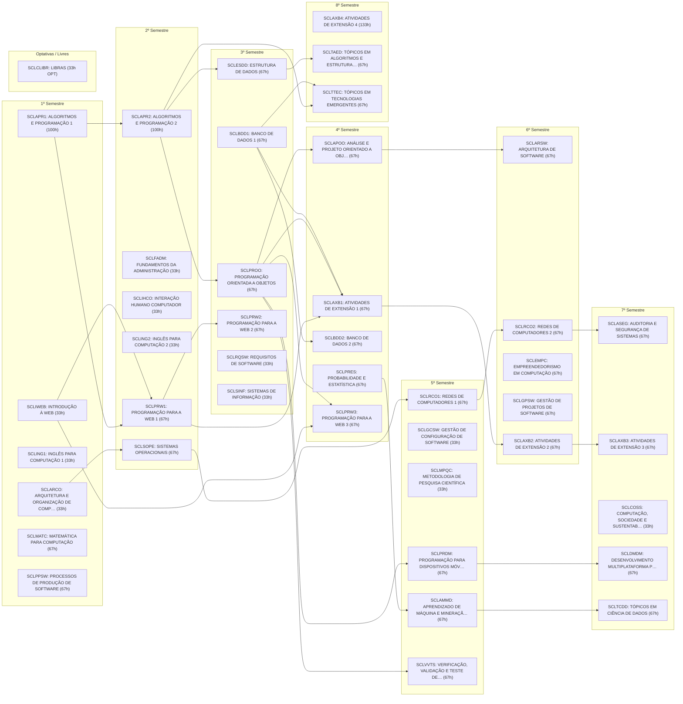
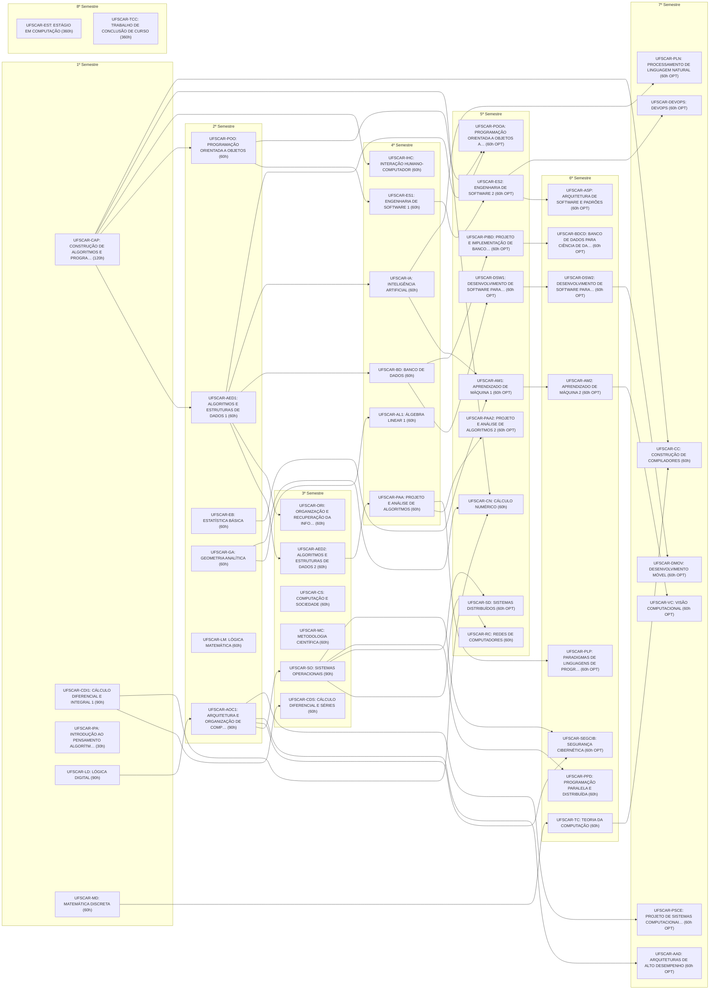
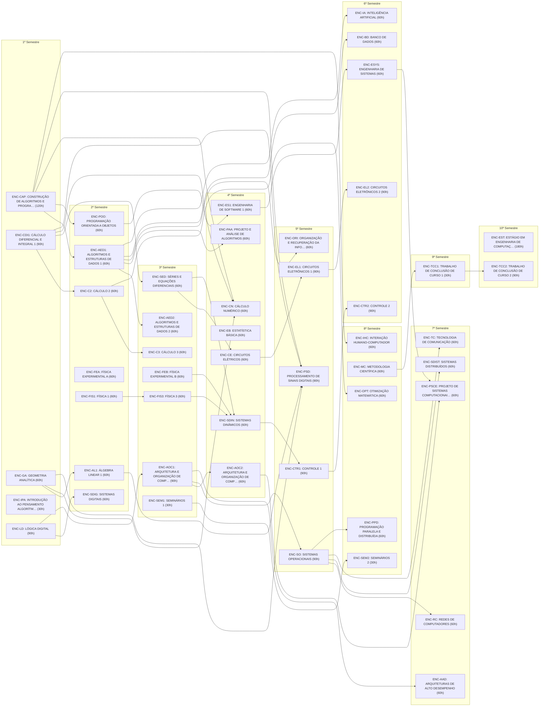
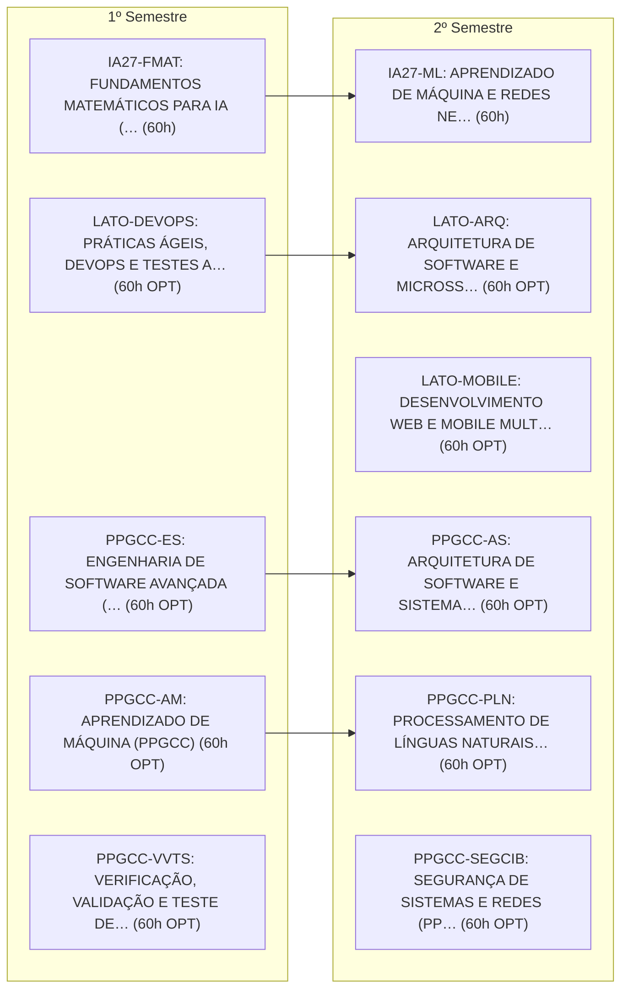

# Fluxogramas Completos em Mermaid por Instituto de Ensino & Equivalências (IFSP · USP · UFSCar)

Documento gerado automaticamente pelo motor multi-institucional (`usp_jupiter.py` + `knowledge_base.py`) para compactação de tokens no chat do PPChat.

## Matriz de Equivalências para Disciplinas Pendentes no BES/IFSP

| IFSP BES (Pendente) | Curso Oferente | Código | Disciplina | CH Ext/IFSP | Aderência |
| :--- | :--- | :--- | :--- | :--- | :--- |
| `SCLARSW` (ARQUITETURA DE SOFTWARE) | USP · BSI (CAASO) | `SSC0725` | ARQUITETURA DE SOFTWARE | 90h / 66.7h | 99% (Alta) |
| `SCLARSW` (ARQUITETURA DE SOFTWARE) | USP · BCI / Comp. (CAASO) | `SSC0725` | ARQUITETURA DE SOFTWARE | 90h / 66.7h | 99% (Alta) |
| `SCLVVTS` (VERIFICAÇÃO, VALIDAÇÃO E TESTE DE SOFTWARE) | USP · BSI (CAASO) | `SSC0524` | VERIFICAÇÃO, VALIDAÇÃO E TESTE DE SOFTWARE | 60h / 66.7h | 99% (Alta) |
| `SCLMATC` (MATEMÁTICA PARA COMPUTAÇÃO) | USP · Estatística (CAASO) | `SMA0805` | TÓPICOS DE MATEMÁTICA | 60h / 66.7h | 99% (Alta) |
| `SCLVVTS` (VERIFICAÇÃO, VALIDAÇÃO E TESTE DE SOFTWARE) | UFSCar · IA (2027) & Pós/Especialização | `PPGCC-VVTS` | VERIFICAÇÃO, VALIDAÇÃO E TESTE DE SOFTWARE (PPGCC) | 60h / 66.7h | 99% (Alta) |
| `SCLVVTS` (VERIFICAÇÃO, VALIDAÇÃO E TESTE DE SOFTWARE) | USP · BCI / Comp. (CAASO) | `SSC0959` | TESTE E INSPEÇÃO DE SOFTWARE | 60h / 66.7h | 96% (Alta) |
| `SCLPRDM` (PROGRAMAÇÃO PARA DISPOSITIVOS MÓVEIS) | USP · BCI / Comp. (CAASO) | `SCC0225` | LABORATÓRIO DE DESENVOLVIMENTO DE APLICAÇÕES PARA DISPOSITIVOS MÓVEIS | 90h / 66.7h | 95% (Alta) |
| `SCLARSW` (ARQUITETURA DE SOFTWARE) | UFSCar · Ciência da Comp. (BCC) | `UFSCAR-ASP` | ARQUITETURA DE SOFTWARE E PADRÕES | 60h / 66.7h | 95% (Alta) |
| `SCLPRDM` (PROGRAMAÇÃO PARA DISPOSITIVOS MÓVEIS) | UFSCar · Ciência da Comp. (BCC) | `UFSCAR-DMOV` | DESENVOLVIMENTO MÓVEL | 60h / 66.7h | 95% (Alta) |
| `SCLARSW` (ARQUITETURA DE SOFTWARE) | UFSCar · IA (2027) & Pós/Especialização | `LATO-ARQ` | ARQUITETURA DE SOFTWARE E MICROSSERVIÇOS (ESP. 2027) | 60h / 66.7h | 95% (Alta) |
| `SCLMATC` (MATEMÁTICA PARA COMPUTAÇÃO) | UFSCar · Ciência da Comp. (BCC) | `UFSCAR-MD` | MATEMÁTICA DISCRETA | 60h / 66.7h | 92% (Alta) |
| `SCLASEG` (AUDITORIA E SEGURANÇA DE SISTEMAS) | UFSCar · Ciência da Comp. (BCC) | `UFSCAR-SEGCIB` | SEGURANÇA CIBERNÉTICA | 60h / 66.7h | 92% (Alta) |
| `SCLARSW` (ARQUITETURA DE SOFTWARE) | UFSCar · IA (2027) & Pós/Especialização | `PPGCC-AS` | ARQUITETURA DE SOFTWARE E SISTEMAS AUTÔNOMOS (PPGCC) | 60h / 66.7h | 92% (Alta) |
| `SCLPRDM` (PROGRAMAÇÃO PARA DISPOSITIVOS MÓVEIS) | UFSCar · IA (2027) & Pós/Especialização | `LATO-MOBILE` | DESENVOLVIMENTO WEB E MOBILE MULTIPLATAFORMA (ESP. 2027) | 60h / 66.7h | 92% (Alta) |
| `SCLPRDM` (PROGRAMAÇÃO PARA DISPOSITIVOS MÓVEIS) | USP · BSI (CAASO) | `SSC0961` | DESENVOLVIMENTO WEB E MOBILE | 60h / 66.7h | 90% (Alta) |
| `SCLPRDM` (PROGRAMAÇÃO PARA DISPOSITIVOS MÓVEIS) | USP · BCI / Comp. (CAASO) | `SSC0961` | DESENVOLVIMENTO WEB E MOBILE | 60h / 66.7h | 90% (Alta) |
| `SCLPRDM` (PROGRAMAÇÃO PARA DISPOSITIVOS MÓVEIS) | USP · Estatística (CAASO) | `SSC0961` | DESENVOLVIMENTO WEB E MOBILE | 60h / 66.7h | 90% (Alta) |
| `SCLASEG` (AUDITORIA E SEGURANÇA DE SISTEMAS) | UFSCar · IA (2027) & Pós/Especialização | `PPGCC-SEGCIB` | SEGURANÇA DE SISTEMAS E REDES (PPGCC) | 60h / 66.7h | 90% (Alta) |
| `SCLDMDM` (DESENVOLVIMENTO MULTIPLATAFORMA PARA DISPOSITIVOS MÓVEIS) | UFSCar · IA (2027) & Pós/Especialização | `LATO-MOBILE` | DESENVOLVIMENTO WEB E MOBILE MULTIPLATAFORMA (ESP. 2027) | 60h / 66.7h | 90% (Alta) |
| `SCLDMDM` (DESENVOLVIMENTO MULTIPLATAFORMA PARA DISPOSITIVOS MÓVEIS) | USP · BCI / Comp. (CAASO) | `SCC0225` | LABORATÓRIO DE DESENVOLVIMENTO DE APLICAÇÕES PARA DISPOSITIVOS MÓVEIS | 90h / 66.7h | 88% (Alta) |
| `SCLASEG` (AUDITORIA E SEGURANÇA DE SISTEMAS) | USP · BSI (CAASO) | `SSC0547` | ENGENHARIA DE SEGURANÇA | 60h / 66.7h | 88% (Alta) |
| `SCLMATC` (MATEMÁTICA PARA COMPUTAÇÃO) | USP · BCI / Comp. (CAASO) | `SMA0180` | MATEMÁTICA DISCRETA I | 60h / 66.7h | 88% (Alta) |
| `SCLASEG` (AUDITORIA E SEGURANÇA DE SISTEMAS) | USP · BCI / Comp. (CAASO) | `SSC0900` | ENGENHARIA DE SEGURANÇA | 60h / 66.7h | 88% (Alta) |
| `SCLDMDM` (DESENVOLVIMENTO MULTIPLATAFORMA PARA DISPOSITIVOS MÓVEIS) | UFSCar · Ciência da Comp. (BCC) | `UFSCAR-DMOV` | DESENVOLVIMENTO MÓVEL | 60h / 66.7h | 88% (Alta) |
| `SCLAPOO` (ANÁLISE E PROJETO ORIENTADO A OBJETOS) | USP · BSI (CAASO) | `SSC0124` | ANÁLISE E PROJETO ORIENTADOS A OBJETOS | 60h / 66.7h | 85% (Alta) |
| `SCLAPOO` (ANÁLISE E PROJETO ORIENTADO A OBJETOS) | USP · BCI / Comp. (CAASO) | `SSC0124` | ANÁLISE E PROJETO ORIENTADOS A OBJETOS | 60h / 66.7h | 85% (Alta) |
| `SCLAPOO` (ANÁLISE E PROJETO ORIENTADO A OBJETOS) | USP · Estatística (CAASO) | `SSC0124` | ANÁLISE E PROJETO ORIENTADOS A OBJETOS | 60h / 66.7h | 85% (Alta) |
| `SCLVVTS` (VERIFICAÇÃO, VALIDAÇÃO E TESTE DE SOFTWARE) | UFSCar · Ciência da Comp. (BCC) | `UFSCAR-ES2` | ENGENHARIA DE SOFTWARE 2 | 60h / 66.7h | 85% (Alta) |
| `SCLAPOO` (ANÁLISE E PROJETO ORIENTADO A OBJETOS) | UFSCar · Ciência da Comp. (BCC) | `UFSCAR-POOA` | PROGRAMAÇÃO ORIENTADA A OBJETOS AVANÇADA | 60h / 66.7h | 84% (Alta) |
| `SCLASEG` (AUDITORIA E SEGURANÇA DE SISTEMAS) | USP · BCI / Comp. (CAASO) | `SSC0901` | LABORATÓRIO DE ENGENHARIA DE SEGURANÇA | 60h / 66.7h | 82% (Alta) |
| `SCLAPOO` (ANÁLISE E PROJETO ORIENTADO A OBJETOS) | UFSCar · Ciência da Comp. (BCC) | `UFSCAR-ES1` | ENGENHARIA DE SOFTWARE 1 | 60h / 66.7h | 82% (Alta) |
| `SCLVVTS` (VERIFICAÇÃO, VALIDAÇÃO E TESTE DE SOFTWARE) | UFSCar · IA (2027) & Pós/Especialização | `LATO-DEVOPS` | PRÁTICAS ÁGEIS, DEVOPS E TESTES AUTOMATIZADOS (ESP. 2027) | 60h / 66.7h | 82% (Alta) |
| `SCLARSW` (ARQUITETURA DE SOFTWARE) | USP · BSI (CAASO) | `SSC0158` | COMPUTAÇÃO EM NUVEM E ARQUITETURA ORIENTADAS A SERVIÇOS | 60h / 66.7h | 78% (Alta) |
| `SCLARSW` (ARQUITETURA DE SOFTWARE) | USP · BCI / Comp. (CAASO) | `SSC0158` | COMPUTAÇÃO EM NUVEM E ARQUITETURA ORIENTADAS A SERVIÇOS | 60h / 66.7h | 78% (Alta) |
| `SCLDMDM` (DESENVOLVIMENTO MULTIPLATAFORMA PARA DISPOSITIVOS MÓVEIS) | USP · BSI (CAASO) | `SSC0961` | DESENVOLVIMENTO WEB E MOBILE | 60h / 66.7h | 75% (Alta) |
| `SCLDMDM` (DESENVOLVIMENTO MULTIPLATAFORMA PARA DISPOSITIVOS MÓVEIS) | USP · BCI / Comp. (CAASO) | `SSC0961` | DESENVOLVIMENTO WEB E MOBILE | 60h / 66.7h | 75% (Alta) |
| `SCLDMDM` (DESENVOLVIMENTO MULTIPLATAFORMA PARA DISPOSITIVOS MÓVEIS) | USP · Estatística (CAASO) | `SSC0961` | DESENVOLVIMENTO WEB E MOBILE | 60h / 66.7h | 75% (Alta) |

## Calendário e Regras Oficiais — Aluno Especial (2026/2027)

Calendário e Regras Oficiais — Aluno Especial (USP ICMC & UFSCar São Carlos):
1. USP São Carlos (ICMC — Graduação, Resolução CoG 3757):
   - Máximo de 2 disciplinas por semestre; proibido cursar disciplinas do 1º ano; códigos SCC, SMA, SME e SSC; dependente de vagas remanescentes após matrícula regular.
   - Documentos padrão: RG, certificado de conclusão do Ensino Médio e histórico escolar completo (com reprovações).
   - 2º semestre/2026 (referência verificada): inscrições ocorreram em 27–28/07/2026 via formulário do Serviço de Graduação (icmc.usp.br/graduacao/ingresso | grad@icmc.usp.br).
   - 1º semestre/2027 (Calendário Escolar PRG-USP): aulas começam em 01/03/2027 e terminam em 07/07/2027; janela de Estudante Especial no ICMC abre tipicamente na 2ª quinzena de fevereiro (após as interações de matrícula regular; acompanhar icmc.usp.br/graduacao/ingresso a partir de 09–26/02/2027).
   - 2º semestre/2027 (Calendário Escolar PRG-USP): aulas começam em 02/08/2027 e terminam em 13/12/2027; janela de Estudante Especial tipicamente nos últimos dias úteis de julho (acompanhar a partir de 19–30/07/2027).
2. UFSCar São Carlos (Graduação ProGrad/DiGRA — Resolução CoG nº 554/2026 & Administrativo 2027):
   - 2027/1 (Cursos Semestrais):
     * 29/01/2027: Chefias de Departamento indicam vagas para o Edital de Estudante Especial.
     * 05/02/2027: Publicação oficial do Edital de "Estudante Especial" (2027/1) pela DiGRA/ProGrad (prograd.ufscar.br).
     * 10–12/02/2027 (inscrição regular) e 17–18/02/2027 (ajuste); 23/02/2027 deferimento final; 01/03/2027 início das aulas (término 03/07/2027).
     * Atenção: edital de Estudante Especial na graduação da UFSCar atende alunos com vínculo em IES conveniadas ou portadores de diploma (conferir convênio/cláusulas no edital de 05/02/2027).
   - 2027/2 (Cursos Semestrais):
     * 02/07/2027: Indicação de vagas; 08/07/2027: Publicação do Edital de "Estudante Especial" (2027/2); 02/08/2027 início das aulas.
   - PPGCC UFSCar (Mestrado/Pós Stricto Sensu — Aluno Especial):
     * Aceita graduandos cursando o penúltimo ano ou superior da graduação com bom rendimento (ppgcc.ufscar.br/pt-br/processo-seletivo/aluno-especial). Inscrição online semestralmente (jan–fev para 1º sem; jun–início ago para 2º sem).
   - Especialização Lato Sensu DC-UFSCar (Desenvolvimento de Software — Turma 2027):
     * Inscrições abertas de 01/10/2026 a 30/11/2026 (urgente — fecha em 30/11/2026), aceitos em 05/12/2026, aulas a partir de 13/02/2027 (latosensudc.ufscar.br).

---

## Instituto: IFSP São Carlos

### Bacharelado em Engenharia de Software [`ifsp_bes`]
- Disciplinas mapeadas: 43 · Duração: 8 semestres
- PPC: PPC BES IFSP São Carlos (43 disciplinas, 3.207,2h, 8 semestres, integral).

## Instituto: USP São Carlos — ICMC / CAASO

### Bacharelado em Sistemas de Informação (BSI) [`usp_bsi`]
- Disciplinas mapeadas: 84 · Duração: 8 semestres
- PPC: Noturno (seg–sex 18h–23h, sáb manhã/tarde), 50 vagas/ano. Duração ideal 8 semestres (mín 6, máx 12). CH total 3.881h (3.600h obrigatórias, 180h optativas eletivas, 30h AACs, >=10% extensão). Departamentos: SSC, SCC, SMA, SME e SEP/EESC. Certificados Especiais/Ênfases: Engenharia de Software, Desenvolvimento Web, Sistemas Computacionais Avançados e de Alto Desempenho, Ciência de Dados e TI/Negócios (FEA-RP).
- Link PPC: https://web2.icmc.usp.br/SVGRAD/ppp/Projeto_Pedag%C3%B3gico_do_Curso_-_BSI_-_2026-2__2_-aprovado.pdf

```mermaid
flowchart LR
  subgraph S1_USP_BSI["1º Semestre"]
    SMA0505["SMA0505: MATRIZES, VETORES E GEOMETRIA ANA… (60h)"]
    SMA0508["SMA0508: MATEMÁTICA DISCRETA (30h)"]
    SSC0501["SSC0501: INTRODUÇÃO À CIÊNCIA DE COMPUTAÇÃ… (60h)"]
    SSC0502["SSC0502: LABORATÓRIO DE INTRODUÇÃO À CIÊNC… (90h)"]
    SSC0512["SSC0512: ELEMENTOS DE LÓGICA DIGITAL (60h)"]
    SSC0530["SSC0530: INTRODUÇÃO A SISTEMAS DE INFORMAÇ… (60h)"]
    SSC0571["SSC0571: COMPUTAÇÃO E SOCIEDADE: EVOLUÇÃO… (60h)"]
    SSC0599["SSC0599: INFORMAÇÃO PROFISSIONAL EM SISTEM… (15h)"]
  end
  subgraph S2_USP_BSI["2º Semestre"]
    5500002["5500002: SEMINÁRIOS EM GESTÃO ORGANIZACION… (45h OPT)"]
    SCC0502["SCC0502: ALGORITMOS E ESTRUTURAS DE DADOS I (120h)"]
    SMA0501["SMA0501: CÁLCULO I (90h)"]
    SSC0503["SSC0503: INTRODUÇÃO À CIÊNCIA DE COMPUTAÇÃ… (120h)"]
    SSC0513["SSC0513: ORGANIZAÇÃO E ARQUITETURA DE COMP… (90h)"]
    SSC0532["SSC0532: METODOLOGIAS DE DESENVOLVIMENTO D… (30h)"]
  end
  subgraph S3_USP_BSI["3º Semestre"]
    SCC0503["SCC0503: ALGORITMOS E ESTRUTURAS DE DADOS… (90h)"]
    SCC0504["SCC0504: PROGRAMAÇÃO ORIENTADA A OBJETOS (60h)"]
    SME0500["SME0500: CÁLCULO NUMÉRICO (30h)"]
    SME0520["SME0520: INTRODUÇÃO À ESTATÍSTICA (60h)"]
    SSC0533["SSC0533: REQUISITOS DE SOFTWARE (30h)"]
    SSC0541["SSC0541: SISTEMAS OPERACIONAIS I (120h)"]
    SSC0576["SSC0576: SEMINÁRIOS EM COMPUTAÇÃO I (15h ELE)"]
    SSC0960["SSC0960: PROGRAMAÇÃO FUNCIONAL (60h)"]
  end
  subgraph S4_USP_BSI["4º Semestre"]
    SCC0505["SCC0505: INTRODUÇÃO À TEORIA DA COMPUTAÇÃO (60h)"]
    SCC0540["SCC0540: BASES DE DADOS (90h)"]
    SCC0560["SCC0560: INTERAÇÃO HUMANO-COMPUTADOR E EXP… (90h)"]
    SEP0584["SEP0584: CONTABILIDADE PARA COMPUTAÇÃO (30h)"]
    SME0510["SME0510: INTRODUÇÃO À PESQUISA OPERACIONAL (120h)"]
    SSC0124["SSC0124: ANÁLISE E PROJETO ORIENTADOS A OB… (60h)"]
    SSC0524["SSC0524: VERIFICAÇÃO, VALIDAÇÃO E TESTE DE… (60h)"]
    SSC0534["SSC0534: MODELAGEM DE SISTEMAS DE SOFTWARE (60h)"]
    SSC0577["SSC0577: SEMINÁRIOS EM COMPUTAÇÃO II (15h ELE)"]
  end
  subgraph S5_USP_BSI["5º Semestre"]
    SCC0530["SCC0530: INTELIGÊNCIA ARTIFICIAL (90h)"]
    SCC0541["SCC0541: LABORATÓRIO DE BASES DE DADOS (120h)"]
    SEP0324["SEP0324: MODELAGEM DE SISTEMAS (90h)"]
    SSC0535["SSC0535: GERÊNCIA DE CONFIGURAÇÃO, MANUTEN… (30h)"]
    SSC0540["SSC0540: REDES DE COMPUTADORES (120h)"]
    SSC0961["SSC0961: DESENVOLVIMENTO WEB E MOBILE (60h)"]
  end
  subgraph S6_USP_BSI["6º Semestre"]
    SCC0275["SCC0275: INTRODUÇÃO À CIÊNCIA DE DADOS (90h ELE)"]
    SCC0580["SCC0580: ACESSIBILIDADE EM SISTEMAS COMPUT… (60h)"]
    SEP0172["SEP0172: PRÁTICA E GERENCIAMENTO DE PROJET… (75h)"]
    SEP0301["SEP0301: MODELAGEM DE SISTEMAS DE PLANEJAM… (60h)"]
    SEP0566["SEP0566: FUNDAMENTOS DE ECONOMIA (30h)"]
    SME0231["SME0231: ANÁLISE TOPOLÓGICA DE DADOS (120h ELE)"]
    SME0822["SME0822: ANÁLISE MULTIVARIADA E APRENDIZAD… (60h ELE)"]
    SSC0531["SSC0531: GESTÃO DE SISTEMAS DE INFORMAÇÃO (60h)"]
    SSC0536["SSC0536: PROJETO E DESENVOLVIMENTO DE SIST… (90h)"]
    SSC0547["SSC0547: ENGENHARIA DE SEGURANÇA (60h)"]
    SSC0570["SSC0570: EMPREENDEDORISMO (90h)"]
    SSC0770["SSC0770: INTRODUÇÃO AO DESENVOLVIMENTO DE… (120h ELE)"]
    SSC0954["SSC0954: INFRAESTRUTURA PARA COMPUTAÇÃO DE… (90h ELE)"]
  end
  subgraph S7_USP_BSI["7º Semestre"]
    RAD2401["RAD2401: COMÉRCIO ELETRÔNICO (30h ELE)"]
    SCC0270["SCC0270: REDES NEURAIS E APRENDIZADO PROFU… (90h ELE)"]
    SCC0276["SCC0276: APRENDIZADO DE MÁQUINA (90h ELE)"]
    SCC0282["SCC0282: RECUPERAÇÃO DA INFORMAÇÃO (60h ELE)"]
    SCC0561["SCC0561: MULTIMÍDIA (60h ELE)"]
    SCC0570["SCC0570: INTRODUÇÃO A REDES NEURAIS (60h ELE)"]
    SME0130["SME0130: REDES COMPLEXAS (120h ELE)"]
    SME0806["SME0806: ESTATÍSTICA COMPUTACIONAL (120h ELE)"]
    SME0878["SME0878: MINERAÇÃO ESTATÍSTICA DE DADOS (120h ELE)"]
    SSC0158["SSC0158: COMPUTAÇÃO EM NUVEM E ARQUITETURA… (60h ELE)"]
    SSC0528["SSC0528: SISTEMAS COLABORATIVOS: FUNDAMENT… (60h ELE)"]
    SSC0591["SSC0591: ESTÁGIO SUPERVISIONADO I (360h)"]
    SSC0593["SSC0593: PROJETO DE GRADUAÇÃO I (360h ELE)"]
    SSC0595["SSC0595: PROJETO EMPREENDEDOR I (360h ELE)"]
    SSC0597["SSC0597: PROJETO EM INTERCÂMBIO I (360h ELE)"]
    SSC0725["SSC0725: ARQUITETURA DE SOFTWARE (90h ELE)"]
    SSC0950["SSC0950: PROJETO E DESENVOLVIMENTO DE SOFT… (90h ELE)"]
    SSC0962["SSC0962: GESTÃO DA QUALIDADE NO DESENVOLVI… (30h ELE)"]
    SSC0963["SSC0963: INDÚSTRIA 4.0: TECNOLOGIAS E APLI… (30h ELE)"]
    SSC0964["SSC0964: INTRODUÇÃO À COMPUTAÇÃO NO MERCAD… (60h ELE)"]
    SSC0965["SSC0965: STREAMING DE DADOS, MICROSSERVIÇO… (90h ELE)"]
  end
  subgraph S8_USP_BSI["8º Semestre"]
    RAD2810["RAD2810: ANÁLISE DE DADOS PARA GESTÃO DE N… (60h ELE)"]
    SCC0244["SCC0244: MINERAÇÃO A PARTIR DE GRANDES BAS… (45h ELE)"]
    SCC0252["SCC0252: VISUALIZAÇÃO COMPUTACIONAL (75h ELE)"]
    SCC0283["SCC0283: INTRODUÇÃO À WEB SEMÂNTICA (120h ELE)"]
    SME0808["SME0808: SÉRIES TEMPORAIS E APRENDIZADO DI… (60h ELE)"]
    SME0823["SME0823: MODELOS DE REGRESSÃO E APRENDIZAD… (90h ELE)"]
    SSC0592["SSC0592: ESTÁGIO SUPERVISIONADO II (360h)"]
    SSC0594["SSC0594: PROJETO DE GRADUAÇÃO II (360h ELE)"]
    SSC0596["SSC0596: PROJETO EMPREENDEDOR II (360h ELE)"]
    SSC0598["SSC0598: PROJETO EM INTERCÂMBIO II (360h ELE)"]
    SSC0726["SSC0726: REUSO DE SOFTWARE (60h ELE)"]
    SSC0952["SSC0952: INTERNET DAS COISAS (120h ELE)"]
    SSC0958["SSC0958: CRIPTOMOEDAS E BLOCKCHAIN (120h ELE)"]
  end
  SSC0501 --> SCC0502 & SSC0503 & SME0500 & SCC0505
  SSC0512 --> SSC0513
  SCC0502 --> SCC0503 & SCC0504 & SSC0541 & SSC0960
  SMA0501 --> SME0500 & SME0520
  SSC0532 --> SSC0533
  SSC0513 --> SSC0541
  SCC0503 --> SCC0540
  SCC0504 --> SCC0560 & SSC0524 & SSC0534 & SSC0961
  SSC0533 --> SCC0560 & SSC0534
  SME0500 --> SME0510
  SSC0503 --> SCC0530
  SCC0540 --> SCC0541
  SSC0534 --> SSC0535 & SEP0172 & SEP0301
  SSC0541 --> SSC0540
  SCC0560 --> SCC0580
  SSC0530 --> SSC0531 & SSC0570
  SSC0535 --> SSC0536
  SSC0524 --> SSC0536
  SSC0540 --> SSC0547
  SSC0591 --> SSC0592
```

### Bacharelado em Ciências de Computação (BCI/BCC) [`usp_bci`]
- Disciplinas mapeadas: 141 · Duração: 8 semestres
- PPC: Integral, duração ideal 10 semestres (5 anos; mín 8, máx 15). CH total 4.732h (4.125h obrigatórias, 360h optativas eletivas, 30h AACs, 452h extensão curricularizada, 600h estágio + 2 Projetos de Graduação/TCC). Ênfases/Certificados: IA, Ciência de Dados, Engenharia de Dados, Engenharia de Software, Robótica, Sistemas Embarcados e Alto Desempenho.
- Link PPC: https://www.icmc.usp.br/graduacao/ciencias-de-computacao-bacharelado

```mermaid
flowchart LR
  subgraph S1_USP_BCI["1º Semestre"]
    SCC0200["SCC0200: INFORMAÇÃO PROFISSIONAL E TUTORIA… (30h)"]
    SCC0221["SCC0221: INTRODUÇÃO À CIÊNCIA DE COMPUTAÇÃ… (90h)"]
    SCC0222["SCC0222: LABORATÓRIO DE INTRODUÇÃO À CIÊNC… (90h)"]
    SMA0300["SMA0300: GEOMETRIA ANALÍTICA (60h)"]
    SMA0353["SMA0353: CÁLCULO I (60h)"]
    SSC0104["SSC0104: EVOLUÇÃO HISTÓRICA DA COMPUTAÇÃO… (60h)"]
    SSC0109["SSC0109: PRÁTICA EM LÓGICA DIGITAL (60h)"]
    SSC0117["SSC0117: INTRODUÇÃO À LÓGICA DIGITAL (60h)"]
    SSC0180["SSC0180: ELETRÔNICA PARA COMPUTAÇÃO (90h)"]
  end
  subgraph S2_USP_BCI["2º Semestre"]
    5500002["5500002: SEMINÁRIOS EM GESTÃO ORGANIZACION… (45h OPT)"]
    SCC0201["SCC0201: INTRODUÇÃO À CIÊNCIA DE COMPUTAÇÃ… (120h)"]
    SCC0202["SCC0202: ALGORITMOS E ESTRUTURAS DE DADOS I (120h)"]
    SCC0220["SCC0220: LABORATÓRIO DE INTRODUÇÃO À CIÊNC… (60h ELE)"]
    SMA0180["SMA0180: MATEMÁTICA DISCRETA I (60h)"]
    SMA0354["SMA0354: CÁLCULO II (60h)"]
    SMA0392["SMA0392: CÁLCULO I (SEMIPRESENCIAL) (60h OPT)"]
    SMA0394["SMA0394: GEOMETRIA ANALÍTICA (SEMIPRESENCI… (60h OPT)"]
    SSC0108["SSC0108: PRÁTICA EM SISTEMAS DIGITAIS (60h)"]
    SSC0118["SSC0118: SISTEMAS DIGITAIS (60h)"]
  end
  subgraph S3_USP_BCI["3º Semestre"]
    7600005["7600005: FÍSICA I (75h ELE)"]
    7600109["7600109: LABORATÓRIO DE FÍSICA GERAL I (30h ELE)"]
    SCC0215["SCC0215: ORGANIZAÇÃO DE ARQUIVOS (105h)"]
    SCC0216["SCC0216: MODELAGEM COMPUTACIONAL EM GRAFOS (60h)"]
    SCC0303["SCC0303: INTRODUÇÃO A COMPRESSÃO DE DADOS (60h ELE)"]
    SMA0355["SMA0355: CÁLCULO III (60h)"]
    SMA0390["SMA0390: CÁLCULO II (SEMIPRESENCIAL) (60h OPT)"]
    SSC0103["SSC0103: PROGRAMAÇÃO ORIENTADA A OBJETOS (60h)"]
    SSC0119["SSC0119: PRÁTICA EM ORGANIZAÇÃO DE COMPUTA… (60h ELE)"]
    SSC0902["SSC0902: ORGANIZAÇÃO E ARQUITETURA DE COMP… (90h)"]
    SSC0960["SSC0960: PROGRAMAÇÃO FUNCIONAL (60h)"]
  end
  subgraph S4_USP_BCI["4º Semestre"]
    SCC0213["SCC0213: METODOLOGIA DE PESQUISA EM COMPUT… (90h)"]
    SCC0218["SCC0218: ALGORITMOS AVANÇADOS E APLICAÇÕES (90h)"]
    SCC0227["SCC0227: SEMINÁRIOS EM COMPUTAÇÃO I (15h ELE)"]
    SCC0295["SCC0295: ATIVIDADES ACADÊMICAS DE EXTENSÃO… (75h ELE)"]
    SMA0393["SMA0393: CÁLCULO III (SEMIPRESENCIAL) (60h OPT)"]
    SME0123["SME0123: ESTATÍSTICA (60h)"]
    SME0142["SME0142: ÁLGEBRA LINEAR E APLICAÇÕES (90h)"]
    SSC0124["SSC0124: ANÁLISE E PROJETO ORIENTADOS A OB… (60h)"]
    SSC0140["SSC0140: SISTEMAS OPERACIONAIS I (120h)"]
  end
  subgraph S5_USP_BCI["5º Semestre"]
    SCC0210["SCC0210: LABORATÓRIO DE ALGORITMOS AVANÇAD… (105h ELE)"]
    SCC0219["SCC0219: INTRODUÇÃO AO DESENVOLVIMENTO WEB (90h)"]
    SCC0228["SCC0228: SEMINÁRIOS EM COMPUTAÇÃO II (15h ELE)"]
    SCC0240["SCC0240: BASES DE DADOS (120h)"]
    SCC0296["SCC0296: ATIVIDADES ACADÊMICAS DE EXTENSÃO… (75h ELE)"]
    SMA0391["SMA0391: CÁLCULO IV (SEMIPRESENCIAL) (60h OPT)"]
    SME0104["SME0104: CÁLCULO NUMÉRICO (60h)"]
    SME0121["SME0121: PROCESSOS ESTOCÁSTICOS (60h)"]
    SSC0130["SSC0130: ENGENHARIA DE SOFTWARE (90h)"]
    SSC0142["SSC0142: REDES DE COMPUTADORES (120h)"]
    SSC0953["SSC0953: SISTEMAS OPEN SOURCE (90h ELE)"]
    SSC0961["SSC0961: DESENVOLVIMENTO WEB E MOBILE (60h)"]
  end
  subgraph S6_USP_BCI["6º Semestre"]
    SCC0205["SCC0205: TEORIA DA COMPUTAÇÃO E LINGUAGENS… (120h)"]
    SCC0207["SCC0207: COMPUTADORES E SOCIEDADE I (30h)"]
    SCC0211["SCC0211: LABORATÓRIO DE ALGORITMOS AVANÇAD… (105h ELE)"]
    SCC0229["SCC0229: SEMINÁRIOS EM COMPUTAÇÃO III (15h ELE)"]
    SCC0230["SCC0230: INTELIGÊNCIA ARTIFICIAL (90h)"]
    SCC0247["SCC0247: BANCO DE DADOS NOSQL E ARCABOUÇOS… (120h ELE)"]
    SME0110["SME0110: PROGRAMAÇÃO MATEMÁTICA (120h)"]
    SME0231["SME0231: ANÁLISE TOPOLÓGICA DE DADOS (120h ELE)"]
    SSC0770["SSC0770: INTRODUÇÃO AO DESENVOLVIMENTO DE… (120h ELE)"]
    SSC0903["SSC0903: COMPUTAÇÃO DE ALTO DESEMPENHO (90h)"]
    SSC0954["SSC0954: INFRAESTRUTURA PARA COMPUTAÇÃO DE… (90h ELE)"]
  end
  subgraph S7_USP_BCI["7º Semestre"]
    SCC0209["SCC0209: EMPREENDEDORES EM INFORMÁTICA (90h ELE)"]
    SCC0217["SCC0217: LINGUAGENS DE PROGRAMAÇÃO E COMPI… (120h)"]
    SCC0241["SCC0241: LABORATÓRIO DE BASES DE DADOS (120h ELE)"]
    SCC0243["SCC0243: ARQUITETURA DE SISTEMAS GERENCIAD… (120h ELE)"]
    SCC0245["SCC0245: PROCESSAMENTO ANALÍTICO DE DADOS (105h ELE)"]
    SCC0250["SCC0250: COMPUTAÇÃO GRÁFICA (90h)"]
    SCC0251["SCC0251: PROCESSAMENTO DE IMAGENS (90h ELE)"]
    SCC0260["SCC0260: INTERAÇÃO HUMANO-COMPUTADOR E EXP… (90h ELE)"]
    SCC0261["SCC0261: MULTIMÍDIA (30h ELE)"]
    SCC0270["SCC0270: REDES NEURAIS E APRENDIZADO PROFU… (90h ELE)"]
    SCC0276["SCC0276: APRENDIZADO DE MÁQUINA (90h ELE)"]
    SCC0282["SCC0282: RECUPERAÇÃO DA INFORMAÇÃO (60h ELE)"]
    SCC0284["SCC0284: SISTEMAS DE RECOMENDAÇÃO (90h ELE)"]
    SCC0370["SCC0370: INTRODUÇÃO À COMPUTAÇÃO BIOINSPIR… (60h ELE)"]
    SCC0633["SCC0633: PROCESSAMENTO DE LINGUAGEM NATURAL (90h ELE)"]
    SCC0910["SCC0910: TÓPICOS AVANÇADOS EM CIÊNCIAS DE… (105h ELE)"]
    SME0130["SME0130: REDES COMPLEXAS (120h ELE)"]
    SME0806["SME0806: ESTATÍSTICA COMPUTACIONAL (120h ELE)"]
    SSC0120["SSC0120: SISTEMAS DE INFORMAÇÃO (60h)"]
    SSC0141["SSC0141: PRÁTICA EM SISTEMAS OPERACIONAIS (120h ELE)"]
    SSC0147["SSC0147: TÓPICOS ESPECIAIS EM SISTEMAS DE… (45h ELE)"]
    SSC0154["SSC0154: SEMINÁRIOS AVANÇADOS EM SISTEMAS… (45h ELE)"]
    SSC0158["SSC0158: COMPUTAÇÃO EM NUVEM E ARQUITETURA… (60h ELE)"]
    SSC0160["SSC0160: MODELAGEM E SIMULAÇÃO DE SISTEMAS… (105h ELE)"]
    SSC0712["SSC0712: PROGRAMAÇÃO DE ROBÔS MÓVEIS (120h ELE)"]
    SSC0714["SSC0714: ROBÔS MÓVEIS AUTÔNOMOS (90h ELE)"]
    SSC0723["SSC0723: SISTEMAS COLABORATIVOS: FUNDAMENT… (30h ELE)"]
    SSC0725["SSC0725: ARQUITETURA DE SOFTWARE (90h ELE)"]
    SSC0740["SSC0740: SISTEMAS EMBARCADOS (105h ELE)"]
    SSC0900["SSC0900: ENGENHARIA DE SEGURANÇA (60h)"]
    SSC0904["SSC0904: SISTEMAS COMPUTACIONAIS DISTRIBUÍ… (60h)"]
    SSC0950["SSC0950: PROJETO E DESENVOLVIMENTO DE SOFT… (90h ELE)"]
    SSC0951["SSC0951: DESENVOLVIMENTO DE CÓDIGO OTIMIZA… (90h ELE)"]
    SSC0959["SSC0959: TESTE E INSPEÇÃO DE SOFTWARE (60h ELE)"]
  end
  subgraph S8_USP_BCI["8º Semestre"]
    IAU0126["IAU0126: HUMANIDADES E CIÊNCIAS SOCIAIS (30h OPT)"]
    SCC0225["SCC0225: LABORATÓRIO DE DESENVOLVIMENTO DE… (90h ELE)"]
    SCC0231["SCC0231: INTRODUÇÃO A SISTEMAS INTELIGENTES (75h ELE)"]
    SCC0233["SCC0233: APLICAÇÕES DE APRENDIZADO DE MÁQU… (90h ELE)"]
    SCC0244["SCC0244: MINERAÇÃO A PARTIR DE GRANDES BAS… (45h ELE)"]
    SCC0252["SCC0252: VISUALIZAÇÃO COMPUTACIONAL (75h ELE)"]
    SCC0254["SCC0254: INTRODUÇÃO À GEOMETRIA COMPUTACIO… (120h ELE)"]
    SCC0271["SCC0271: INTRODUÇÃO À BIOINFORMÁTICA (60h ELE)"]
    SCC0273["SCC0273: ROBÔS MÓVEIS INTELIGENTES (60h ELE)"]
    SCC0275["SCC0275: INTRODUÇÃO À CIÊNCIA DE DADOS (90h ELE)"]
    SCC0277["SCC0277: COMPETIÇÕES DE CIÊNCIAS DE DADOS (90h ELE)"]
    SCC0280["SCC0280: ACESSIBILIDADE EM SISTEMAS COMPUT… (60h ELE)"]
    SCC0283["SCC0283: INTRODUÇÃO À WEB SEMÂNTICA (120h ELE)"]
    SCC0287["SCC0287: MINERAÇÃO DE DADOS NÃO ESTRUTURAD… (90h ELE)"]
    SCC0911["SCC0911: TÓPICOS AVANÇADOS EM CIÊNCIAS DE… (105h ELE)"]
    SME0808["SME0808: SÉRIES TEMPORAIS E APRENDIZADO DI… (60h ELE)"]
    SME0822["SME0822: ANÁLISE MULTIVARIADA E APRENDIZAD… (60h ELE)"]
    SME0823["SME0823: MODELOS DE REGRESSÃO E APRENDIZAD… (90h ELE)"]
    SSC0123["SSC0123: TÓPICOS ESPECIAIS EM ENGENHARIA D… (45h ELE)"]
    SSC0128["SSC0128: GERÊNCIA DE PROJETOS (75h ELE)"]
    SSC0152["SSC0152: ADMINISTRAÇÃO E GERENCIAMENTO DE… (105h ELE)"]
    SSC0159["SSC0159: TÓPICOS AVANÇADOS EM COMPUTAÇÃO D… (45h ELE)"]
    SSC0643["SSC0643: AVALIAÇÃO DE DESEMPENHO DE SISTEM… (75h ELE)"]
    SSC0713["SSC0713: SISTEMAS EVOLUTIVOS E APLICADOS À… (90h ELE)"]
    SSC0715["SSC0715: SENSORES INTELIGENTES (120h ELE)"]
    SSC0720["SSC0720: ENGENHARIA DE SOFTWARE PARA SISTE… (75h ELE)"]
    SSC0724["SSC0724: SISTEMAS EDUCACIONAIS AVANÇADOS (45h ELE)"]
    SSC0726["SSC0726: REUSO DE SOFTWARE (60h ELE)"]
    SSC0741["SSC0741: PROJETO E IMPLEMENTAÇÃO DE SISTEM… (135h ELE)"]
    SSC0744["SSC0744: COMPUTAÇÃO DISTRIBUÍDA (135h ELE)"]
    SSC0745["SSC0745: SISTEMAS COMPUTACIONAIS DE TEMPO-… (45h ELE)"]
    SSC0748["SSC0748: REDES MÓVEIS (105h ELE)"]
    SSC0901["SSC0901: LABORATÓRIO DE ENGENHARIA DE SEGU… (60h ELE)"]
    SSC0952["SSC0952: INTERNET DAS COISAS (120h ELE)"]
    SSC0958["SSC0958: CRIPTOMOEDAS E BLOCKCHAIN (120h ELE)"]
  end
  subgraph S9_USP_BCI["9º Semestre"]
    SCC0289["SCC0289: PROJETO EM INTERCÂMBIO I (360h ELE)"]
    SCC0291["SCC0291: ESTÁGIO SUPERVISIONADO I (360h)"]
    SCC0293["SCC0293: PROJETO DE GRADUAÇÃO I (360h ELE)"]
    SCC0300["SCC0300: PROJETO EMPREENDEDOR I (360h ELE)"]
    SME0878["SME0878: MINERAÇÃO ESTATÍSTICA DE DADOS (120h ELE)"]
  end
  subgraph S10_USP_BCI["10º Semestre"]
    SCC0290["SCC0290: PROJETO EM INTERCÂMBIO II (360h ELE)"]
    SCC0292["SCC0292: ESTÁGIO SUPERVISIONADO II (360h)"]
    SCC0294["SCC0294: PROJETO DE GRADUAÇÃO II (360h ELE)"]
    SCC0302["SCC0302: PROJETO EMPREENDEDOR II (360h ELE)"]
    SSC0967["SSC0967: INTELIGÊNCIA ARTIFICIAL EMBARCADA (90h ELE)"]
  end
  SCC0221 --> SCC0201
  SMA0353 --> SMA0354 & SME0104
  SSC0117 --> SSC0118
  SCC0202 --> SCC0215 & SCC0216 & SSC0103 & SSC0960 & SSC0140
  SCC0201 --> SCC0215 & SCC0205 & SCC0230
  SMA0354 --> SMA0355 & SME0123
  SSC0118 --> SSC0902
  SCC0216 --> SCC0218
  SSC0103 --> SSC0124 & SCC0250
  SSC0902 --> SSC0140 & SSC0903 & SSC0643
  SCC0215 --> SCC0240
  SME0142 --> SME0104
  SME0123 --> SME0121
  SSC0124 --> SSC0130
  SSC0140 --> SSC0142 & SSC0903 & SSC0904
  SME0104 --> SME0110
  SCC0205 --> SCC0217
  SSC0142 --> SSC0900 & SSC0904
  SCC0291 --> SCC0292
```

### Bacharelado em Estatística e Ciência de Dados [`usp_est`]
- Disciplinas mapeadas: 79 · Duração: 8 semestres
- PPC: Noturno, 40 vagas/ano, duração ideal 8 semestres (4 anos; alinhado às diretrizes MEC >=3.000h e >=10% extensão). Núcleo em matemática, probabilidade, inferência estatística, computação, aprendizado de máquina e visualização de dados.
- Link PPC: https://www.icmc.usp.br/graduacao/estatistica-bacharelado

## Instituto: UFSCar São Carlos — DC / CCET & PPGCC

### Bacharelado em Ciência da Computação (BCC) [`ufscar_bcc`]
- Disciplinas mapeadas: 49 · Duração: 8 semestres
- PPC: Integral (matutino/vespertino), 60 vagas, 8 semestres, CH total 3.240h (1.830h obrigatórias [1.770h T/P + 60h Ext], 540h optativas de trilha [9x 60h nos semestres 5–7], 360h Estágio ou TCC no 8º sem, 300h ACE/PIE/ACIEPE, 210h ACs). Optativas fortes para BES: Engenharia de Software 2 (testes), Arquitetura de Software e Padrões, Desenvolvimento Móvel, Segurança Cibernética e DevOps.
- Link PPC: https://www.prograd.ufscar.br/pt-br/assets/arquivos/cursos/cursos-oferecidos/ciencias-da-computacao/ppc_bel-ciencia_da_computacao_2025.pdf

### Bacharelado em Engenharia de Computação (ENC) [`ufscar_enc`]
- Disciplinas mapeadas: 49 · Duração: 10 semestres
- PPC: Integral (matutino/vespertino), 30 vagas, 10 semestres, CH total 3.660h. Matriz 2025 combina Matemática, Física, Eletrônica, Computação, Engenharia de Software 1, Sistemas Operacionais, Redes, Banco de Dados, IA, Sistemas Distribuídos, Embarcados, 180h Estágio + TCC 1 e 2 + ACEs.
- Link PPC: https://www.prograd.ufscar.br/pt-br/assets/arquivos/cursos/cursos-oferecidos/engenharia-de-computacao/PPC_EC_2019.pdf

### IA (2027) · PPGCC (CAPES 5) · Especialização Dev. Software [`ufscar_ia_pos`]
- Disciplinas mapeadas: 11 · Duração: 4 semestres
- PPC: Reúne: (1) Novo Bacharelado em Inteligência Artificial (previsto 2027 no CCET/São Carlos); (2) Mestrado/Doutorado PPGCC (CAPES 5; 47 vagas 2027/1 em ES, AMPLN, BD, CCH, SDARC, VC, SAR; aceita graduando no penúltimo ano ou último ano como Aluno Especial); (3) Especialização Lato Sensu DC 'Computação – Desenvolvimento de Software' (inscrições 01/10–30/11/2026, início 13/02/2027: Ágil, DevOps, Arquitetura, Testes Automatizados, ML e IA).
- Link PPC: https://www.ppgcc.ufscar.br/pt-br/processo-seletivo/aluno-especial

